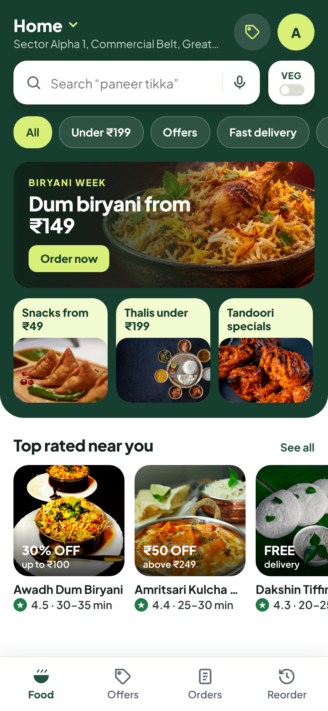
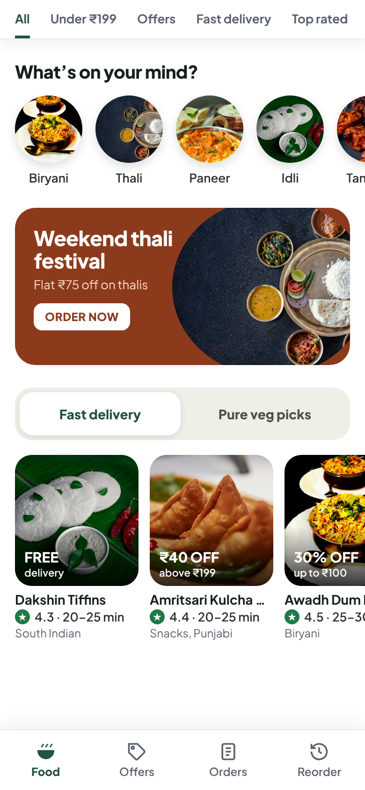
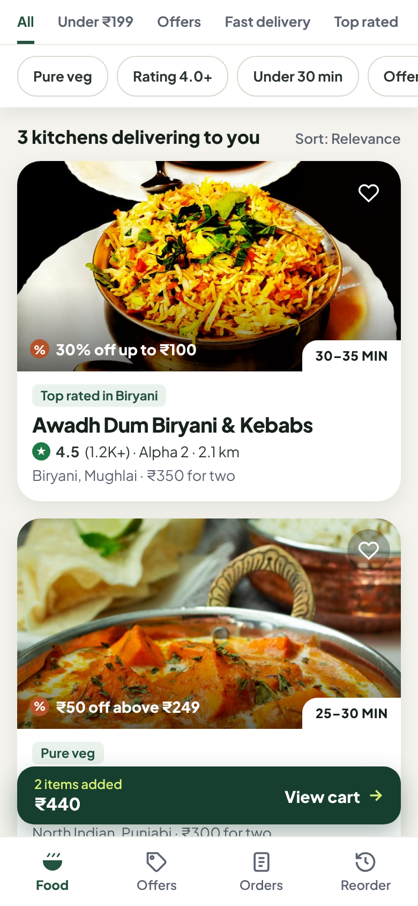
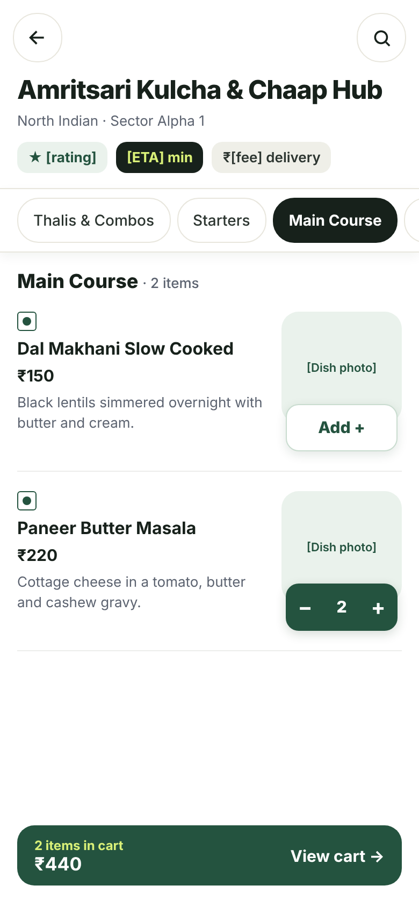
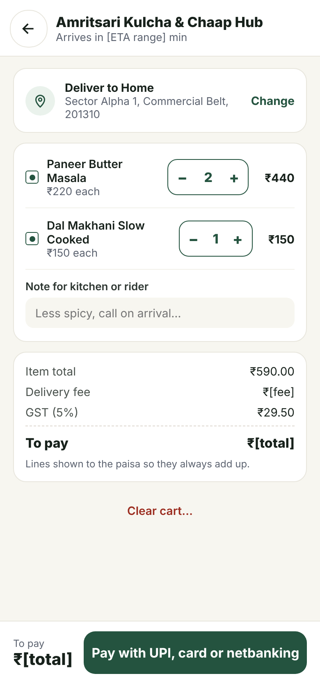
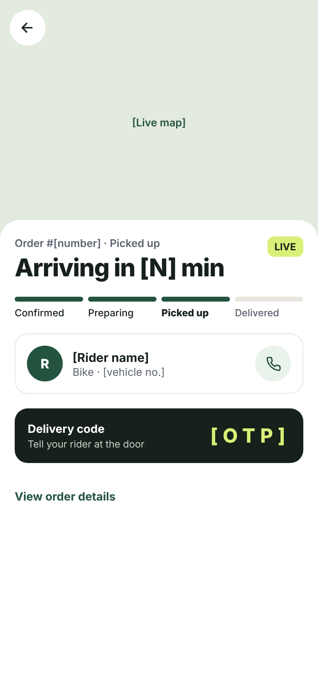

# Fleet24 Customer App — UI v2 Implementation Spec

As of 2026-11-17. Source of truth for the customer-app UI v2 work. The target screens are in `screens/`.

## Overview

This spec turns the Fleet24 customer app (`customer-app/`, Expo SDK 58, React Native 0.88) into a marketplace-style UI, in six phases a coding agent can ship one PR at a time.

**In scope:** Home (top, discovery rails, restaurant feed), restaurant menu, cart, live tracking, design tokens, shared components, accessibility fixes, and moving navigation to Expo Router.

**Out of scope:** rider and restaurant apps, admin dashboard, payment provider logic, backend ranking.

| Phase | What ships | Main files |
| --- | --- | --- |
| 1 | One token set, brand font, base components | `src/theme/tokens.ts`, `src/components/ui/*` |
| 2 | Accessibility fixes: stepper, veg mark, contrast, labels | `QuantityStepper.tsx`, `VegBadge.tsx`, `MenuItemCard.tsx` |
| 3 | Home v2: header, search, chips, banner, rails, feed cards | `HomeScreen.tsx`, `RestaurantCard.tsx`, new `src/components/home/*` |
| 4 | Menu, cart and tracking screens | `RestaurantDetailScreen.tsx`, `CartScreen.tsx`, `DeliveryTrackingScreen.tsx` |
| 5 | Expo Router navigation with deep links | `App.tsx` → `src/app/*` |
| 6 | Real API fields replace sample values | `backend/`, `src/api/*`, `mockData.ts` |

Ratings, delivery times, offers and price-for-two in the mock-ups are **sample values**. The API does not return them yet (see API fields); until it does, the UI hides those slots instead of showing fake numbers.

## Target screens

All frames are 390 × 844 (iPhone 14/15 logical size). Build to these, then check at 360 px wide (small Android) so that nothing clips.

### 1. Home — top



- Dark green header (`#173F2F`) with 28 px bottom corner radius. It holds the address button ("Home ▾" + one-line address), an Offers icon button and the profile avatar (lime circle).
- Search bar (52 px tall, white, 16 px radius, shadow) with a voice icon, plus a separate 64 × 52 VEG switch.
- Filter chips on the green: All · Under ₹199 · Offers · Fast delivery · Top rated. The selected chip is lime with green text.
- Campaign banner (150 px, 20 px radius): photo, green gradient from the left, eyebrow "BIRYANI WEEK", headline, and a lime "Order now" button.
- Three lime offer tiles (112 × 124), each with a title and a photo.
- "Top rated near you" rail: 132 px square photo cards with the offer on the image, then name, then a green star badge · rating · ETA.
- Bottom tab bar: Food · Offers · Orders · Reorder.

### 2. Home — discovery (scrolled)



- When the header scrolls away, the chip row sticks to the top as an underline tab bar.
- "What’s on your mind?": 72 px round photos with labels.
- Promo banner in terracotta `#8C3A1C` with a round food photo bleeding off the right edge.
- Segmented control: Fast delivery | Pure veg picks. Switching it swaps the rail below.
- The rail cards add a cuisine line under rating · ETA.

### 3. Home — restaurant feed



- The sticky header now has two rows: underline tabs, then toggle chips (Pure veg, Rating 4.0+, Under 30 min, Offers).
- "N kitchens delivering to you" + Sort.
- Large card (22 px radius, soft shadow): 196 px photo with a dark bottom gradient; the offer bottom-left with a terracotta % mark; the ETA in a white tag bottom-right; a save heart top-right.
- Card body: a badge ("Top rated in Biryani" / "Pure veg"), the name (19 px/800), a star badge with rating (count) · area · km, then cuisines · ₹ for two.
- A floating View cart bar (dark green, lime caption) sits above the tab bar.

### 4. Menu



- 44 px back and search buttons; the name (24 px/800); cuisine · area; three pills: rating, ETA, delivery fee.
- Sticky category tabs that scroll to sections (not filters).
- Item row: veg mark, name, price, 2-line description, 112 × 104 photo, and an Add button that becomes a 104 × 44 stepper in place.

### 5. Cart



- Header with the restaurant name and "Arrives in X–Y min" from the API.
- Address card, item rows with a 44 px stepper, and a note field.
- Bill shown to the paisa.
- "Clear cart…" asks for confirmation.
- Sticky pay bar.

### 6. Live tracking



- Map on top; a sheet with "Arriving in N min".
- A 4-step progress bar: Confirmed → Preparing → Picked up → Delivered.
- Rider card with a Call button.
- Dark delivery-code card with the OTP in lime.

## API fields the UI needs (Phase 6)

The backend (`backend/src/restaurants`) returns no rating, cuisine, ETA, price-for-two or offers today; the schema has none of these columns. Operating hours already exist (`outlet_operating_hours`). Until each field ships, the client hides its slot. It never shows a hard-coded value like today's "30 min".

| Field | On | Type | Shown as | Fallback when missing |
| --- | --- | --- | --- | --- |
| `cuisines` | outlet | `string[]` | "North Indian, Punjabi" | Hide line |
| `rating` | outlet | `number` (1 dp) | Green star badge "4.4" | Hide badge; show "New" if `ratingCount` < 20 |
| `ratingCount` | outlet | `number` | "(860+)" | Hide |
| `etaMinutes` | outlet (per address) | `{ min: number; max: number }` | "25–30 MIN" tag | Hide tag |
| `priceForTwo` | outlet | `number` (₹) | "₹300 for two" | Hide |
| `offer` | outlet | `{ title: string; subtitle?: string }` | "30% off up to ₹100" | No overlay |
| `badges` | outlet | `string[]` | "Top rated in Biryani", "Pure veg" | Hide |
| `isPureVeg` | outlet | `boolean` | Pure veg filter and badge | Derive from menu |
| `nextOpenAt` | outlet | ISO time | "Opens at 11:00" when closed | "Currently closed" |
| `cuisineTags` | menu category | `string[]` | Real cuisine filter (replaces name substring match) | Hide chip |
| `etaMinutes` | cart quote | `{ min; max }` | Cart header "Arrives in 25–35 min" | Hide line |
| `etaMinutes`, `rider.phone` | tracking | number, string | "Arriving in N min", Call button | Hide |

Extend `OutletSummary` in `src/components/RestaurantCard.tsx` (or move it to `src/api/types.ts`) with these as **optional** fields so the current API keeps working. Put sample values only in `mockData.ts`, behind `USE_MOCK_DATA`.

## Design tokens (Phase 1)

Replace both `colors` and `exploreColors` with one set. Every text colour below is at least 4.5:1 on white and on `ground`. Keep the old export names as aliases for one release so screens can migrate one at a time, then delete them.

| Token | Value | Use | Contrast |
| --- | --- | --- | --- |
| `brand` | `#24533F` | Buttons, links, selected states | 8.8:1 with white |
| `brandDeep` | `#173F2F` | Home header, floating cart bar | 11.7:1 with white |
| `brandPressed` | `#132C21` | Pressed state only | — |
| `lime` | `#D9F078` | Selected chip, CTA on dark green, OTP digits | 13.1:1 with ink; never text on white |
| `limeSoft` | `#F3FCD0` | Offer tiles | — |
| `ink` | `#17211B` | All primary text | 16:1 |
| `textSecondary` | `#5C6370` | Captions, placeholders, icons | 6.0:1 white, 5.6:1 ground |
| `ground` | `#F7F6F0` | Screen background | — |
| `feed` | `#F4F3EE` | Feed background behind white cards | — |
| `surface` | `#FFFFFF` | Cards, sheets | — |
| `line` | `#E8E6DD` | Borders, dividers | — |
| `greenSoft` | `#EAF2EC` | Badges, avatar fallback | — |
| `rating` | `#1E7A46` | Star badge | 5.4:1 with white |
| `offer` | `#B4532A` | Offer % mark, warnings | 5.0:1 with white |
| `promo` | `#8C3A1C` | Promo banner background | 7.7:1 with white |
| `danger` | `#B42318` | Errors, non-veg mark | 6.5:1 |

```ts
// src/theme/tokens.ts
export const palette = {
  brand: '#24533F', brandDeep: '#173F2F', brandPressed: '#132C21',
  lime: '#D9F078', limeSoft: '#F3FCD0',
  ink: '#17211B', textSecondary: '#5C6370', textOnDark: '#C9D8CE',
  ground: '#F7F6F0', feed: '#F4F3EE', surface: '#FFFFFF', line: '#E8E6DD',
  greenSoft: '#EAF2EC', rating: '#1E7A46', offer: '#B4532A', promo: '#8C3A1C',
  danger: '#B42318', veg: '#24533F', nonVeg: '#B42318',
} as const;

export const font = {
  regular: 'PlusJakartaSans_400Regular',
  medium: 'PlusJakartaSans_500Medium',
  semibold: 'PlusJakartaSans_600SemiBold',
  bold: 'PlusJakartaSans_700Bold',
  extrabold: 'PlusJakartaSans_800ExtraBold',
} as const;

// Minimum sizes: 11 for badges, 12 for any sentence.
export const type = {
  display: { fontFamily: font.extrabold, fontSize: 24, lineHeight: 28, letterSpacing: -0.5, color: palette.ink },
  title:   { fontFamily: font.extrabold, fontSize: 19, lineHeight: 24, letterSpacing: -0.3, color: palette.ink },
  cardTitle: { fontFamily: font.extrabold, fontSize: 19, lineHeight: 23, letterSpacing: -0.4, color: palette.ink },
  itemTitle: { fontFamily: font.bold, fontSize: 16, lineHeight: 21, color: palette.ink },
  body:    { fontFamily: font.medium, fontSize: 14, lineHeight: 20, color: palette.ink },
  meta:    { fontFamily: font.medium, fontSize: 13, lineHeight: 18, color: palette.textSecondary },
  label:   { fontFamily: font.bold, fontSize: 13, lineHeight: 16, color: palette.ink },
  caption: { fontFamily: font.semibold, fontSize: 12, lineHeight: 16, color: palette.textSecondary },
  badge:   { fontFamily: font.extrabold, fontSize: 11, lineHeight: 14, letterSpacing: 0.4 },
} as const;

export const radius = { tag: 8, control: 12, tile: 16, card: 22, sheet: 28, full: 999 } as const;
export const space = { xs: 4, sm: 8, md: 12, lg: 16, xl: 20, xxl: 24, xxxl: 32 } as const;
export const hit = 44; // minimum touch target in px

export const shadow = {
  card: { boxShadow: '0px 6px 18px rgba(23, 33, 27, 0.08)' },
  float: { boxShadow: '0px 10px 24px rgba(23, 63, 47, 0.35)' },
  search: { boxShadow: '0px 6px 16px rgba(0, 0, 0, 0.18)' },
} as const;

/** @deprecated aliases — remove after Phase 4 */
export const colors = { primary: palette.brand, background: palette.ground, surface: palette.surface,
  textPrimary: palette.ink, textSecondary: palette.textSecondary, textMuted: palette.textSecondary,
  border: palette.line, accent: palette.offer, error: palette.danger, veg: palette.veg, nonVeg: palette.nonVeg } as const;
```

Font: install with `npx expo install expo-font @expo-google-fonts/plus-jakarta-sans`, then load the five weights with `useFonts` in the root layout and keep the splash screen up until they load. The unused `Baskervville`/`InstrumentSerif` references in `HomeScreen.tsx` and `RestaurantCard.tsx` are never loaded; delete them.

Radii collapse from ten values (8, 10, 12, 14, 16, 18, 20, 22, 24, 28) to the six in `radius`.

## Code changes, file by file

Paths are relative to `customer-app/`. New shared components go in `src/components/ui/` (generic) and `src/components/home/` (Home only). Every touchable gets `accessibilityRole` and, if it shows only an icon, an `accessibilityLabel`.

### Phase 1 — base components

**`src/components/ui/Chip.tsx`** (new): a pill toggle used on the green header, in the feed filters and on menu tabs.

```tsx
import { Pressable, Text, StyleSheet } from 'react-native';
import { palette, type, hit } from '../../theme/tokens';

type Tone = 'onDark' | 'onLight';
export function Chip({ label, selected, onPress, tone = 'onLight' }:
  { label: string; selected: boolean; onPress: () => void; tone?: Tone }) {
  const s = tone === 'onDark'
    ? (selected ? styles.darkOn : styles.darkOff)
    : (selected ? styles.lightOn : styles.lightOff);
  const t = tone === 'onDark'
    ? (selected ? palette.brandDeep : '#FFFFFF')
    : (selected ? '#FFFFFF' : palette.ink);
  return (
    <Pressable accessibilityRole="button" accessibilityState={{ selected }} onPress={onPress}
      hitSlop={(hit - 36) / 2} style={[styles.base, s]}>
      <Text style={[type.label, { color: t }]}>{label}</Text>
    </Pressable>
  );
}
const styles = StyleSheet.create({
  base: { height: 36, paddingHorizontal: 14, borderRadius: 18, justifyContent: 'center', borderWidth: 1 },
  darkOn: { backgroundColor: palette.lime, borderColor: palette.lime },
  darkOff: { backgroundColor: 'rgba(255,255,255,0.10)', borderColor: 'rgba(255,255,255,0.22)' },
  lightOn: { backgroundColor: palette.brand, borderColor: palette.brand },
  lightOff: { backgroundColor: palette.surface, borderColor: '#DDD7CF' },
});
```

**`src/components/ui/RatingLine.tsx`** (new): a green circle with a star, then the rating text. Returns `null` when there is nothing to show.

```tsx
export function RatingLine({ rating, count, trailing }: { rating?: number; count?: string; trailing?: string }) {
  if (rating == null && !trailing) return null;
  const label = [rating != null ? 'Rated ' + rating : null, trailing].filter(Boolean).join(', ');
  return (
    <View style={{ flexDirection: 'row', alignItems: 'center', gap: 5 }} accessible accessibilityLabel={label}>
      {rating != null && (
        <View style={{ width: 17, height: 17, borderRadius: 9, backgroundColor: palette.rating,
          alignItems: 'center', justifyContent: 'center' }}>
          <Ionicons name="star" size={10} color="#FFFFFF" />
        </View>
      )}
      <Text style={type.body}>
        {rating != null && <Text style={{ fontFamily: font.extrabold }}>{rating.toFixed(1)}</Text>}
        {count ? ' (' + count + ')' : ''}
        {trailing ? (rating != null ? ' · ' : '') + trailing : ''}
      </Text>
    </View>
  );
}
```

**`src/components/ui/FloatingCartBar.tsx`**: rewrite `CartSummaryBar.tsx`.

- Height 54, `radius.tile`, `brandDeep` background, `shadow.float`.
- Left: caption "N items added" in lime 12/600 above the total 16/800. Right: "View cart" + a lime arrow.
- Accessibility label: "View cart, N items, ₹total".
- Sits 12 px above the tab bar, or 20 px above the safe-area bottom on screens without tabs.

**`src/components/ui/ConfirmSheet.tsx`** (new): bottom sheet with a title, message, a destructive or primary confirm button and a cancel button, each 48 px tall. Used for cart replace and clear cart; works the same on web (no `window.confirm`).

### Phase 2 — accessibility fixes

**`src/components/QuantityStepper.tsx`**: increase height from 32 to 44, use 36 × 44 buttons, a solid `brand` fill and a fixed width of 104 (the same as the Add button, so the row does not jump). Add an `itemName` prop.

```tsx
export const QuantityStepper = ({ quantity, onIncrement, onDecrement, itemName, disabled }: Props) => (
  <View style={styles.container} accessibilityRole="adjustable"
    accessibilityLabel={itemName + ', quantity ' + quantity}
    accessibilityActions={[{ name: 'increment' }, { name: 'decrement' }]}
    onAccessibilityAction={(e) => e.nativeEvent.actionName === 'increment' ? onIncrement() : onDecrement()}>
    <Pressable style={styles.btn} onPress={onDecrement} disabled={disabled} accessibilityRole="button"
      accessibilityLabel={(quantity === 1 ? 'Remove ' : 'Remove one ') + itemName}>
      <Ionicons name={quantity === 1 ? 'trash-outline' : 'remove'} size={18} color="#FFFFFF" />
    </Pressable>
    <Text style={styles.qty} accessibilityLiveRegion="polite">{quantity}</Text>
    <Pressable style={styles.btn} onPress={onIncrement} disabled={disabled} accessibilityRole="button"
      accessibilityLabel={'Add one more ' + itemName}>
      <Ionicons name="add" size={18} color="#FFFFFF" />
    </Pressable>
  </View>
);
const styles = StyleSheet.create({
  container: { width: 104, height: 44, borderRadius: radius.control, backgroundColor: palette.brand,
    flexDirection: 'row', alignItems: 'center', justifyContent: 'space-between', ...shadow.card },
  btn: { width: 36, height: 44, alignItems: 'center', justifyContent: 'center' },
  qty: { fontFamily: font.extrabold, fontSize: 15, color: '#FFFFFF' },
});
```

Update both callers (`MenuItemCard.tsx` and `CartScreen.tsx`) to pass `itemName`.

**`src/components/VegBadge.tsx`**: shape and colour together, following the FSSAI marks. Veg is a green square with a circle; non-veg is a red square with a triangle.

```tsx
<View accessible accessibilityRole="image" accessibilityLabel={isVeg ? 'Vegetarian' : 'Non-vegetarian'}
  style={[styles.outer, { width: size, height: size, borderColor: color }]}>
  {isVeg
    ? <View style={{ width: size / 2, height: size / 2, borderRadius: size, backgroundColor: color }} />
    : <View style={{ width: 0, height: 0, borderLeftWidth: size / 4, borderRightWidth: size / 4,
        borderBottomWidth: size / 2.4, borderLeftColor: 'transparent', borderRightColor: 'transparent',
        borderBottomColor: color }} />}
</View>
```

**Contrast and type size sweep (all files):**

- Replace `#9CA3AF`, `#777B80`, `#85898D`, `colors.textMuted` and `exploreColors.secondary` text with `palette.textSecondary`.
- Set every `fontSize` below 11 to 11 or more. Find them with `grep -rnE "fontSize: (9|10)(\.5)?\b" src`; they are in `MenuItemCard.tsx` (OFFER tag), `HomeScreen.tsx` (banner eyebrow, cart badge), `OrdersScreen.tsx`, `ProfileScreen.tsx`, `CartScreen.tsx`, `PaymentConflictModal.tsx`, `AddressSelectionModal.tsx`, `DeliveryOfferCard.tsx` and `DeliveryMapView.tsx`.
- Change the cart badge on the restaurant screen from white on `#E98755` (2.6:1) to white on `palette.brand`.
- Add an `accessibilityLabel` to every icon-only button: the back buttons in `CartScreen.tsx` and `RestaurantDetailScreen.tsx`, and the clear-search buttons.
- Remove the Home notification bell (it has no handler and an always-on dot) until notifications exist.

### Phase 3 — Home v2

Split `src/screens/HomeScreen.tsx` (672 lines) into a thin screen plus these components:

| New file | Renders | Props |
| --- | --- | --- |
| `home/HomeHeader.tsx` | Green block: address button, Offers + avatar, search, VEG switch, chips, campaign banner, offer tiles | `address`, `onAddressPress`, `query`, `onQuery`, `veg`, `onVeg`, `chip`, `onChip`, `campaign`, `tiles` |
| `home/SearchBar.tsx` | 52 px white field with search icon; voice icon hidden until speech is supported | `value`, `onChangeText` |
| `home/VegToggle.tsx` | 64 × 52 card with "VEG" and a `Switch` | `value`, `onChange` |
| `home/CampaignBanner.tsx` | Photo + left gradient (`expo-linear-gradient`) + eyebrow, headline, lime CTA | `section: FeedSection` |
| `home/OfferTile.tsx` | 112 × 124 lime tile, title, photo | `title`, `imageUrl`, `onPress` |
| `home/RailCard.tsx` | 132 px square photo, offer overlay, name, `RatingLine` + ETA, optional cuisine | `outlet`, `onPress`, `showCuisine?` |
| `home/CuisineCircle.tsx` | 72 px round photo + label | `name`, `imageUrl`, `selected`, `onPress` |
| `home/PromoBanner.tsx` | `palette.promo` card, headline, sub, white CTA, round photo off the right edge | `section` |
| `home/SegmentedControl.tsx` | Two 46 px segments on `#EFEFE8` | `options`, `value`, `onChange` |
| `home/StickyFilterBar.tsx` | Underline tabs + filter chips, white with shadow | `tabs`, `tab`, `filters`, `onToggle` |
| `RestaurantCard.tsx` (rewrite) | Feed card in the 196 px photo layout | `outlet`, `onPress`, `onToggleSave?` |

**Screen structure:** a single `FlatList` of outlets. `ListHeaderComponent` = `HomeHeader` + discovery rails. Use `stickyHeaderIndices` with a `StickyFilterBar` item inserted as the first data row, so the bar pins once the header scrolls away. Keep the existing pull-to-refresh and the `requestVersion` race guard.

**Remove:**

- The "Fleet24 Food" identity block.
- The duplicate cuisine chip row; keep the photo circles as the only cuisine picker.
- The static "Big flavour" banner when the API sends a campaign.
- The filter sheet; its one toggle becomes the "Open now" chip.

**Fix filtering:** the cuisine filter uses `outlet.cuisines` (Phase 6); until then, keep the substring match only for mock data. Search should also match dish names once the backend supports `GET /public/outlets?search=`; until then, change the placeholder to "Search kitchens".

**Feed card (`RestaurantCard.tsx`):**

```tsx
const etaText = eta(outlet);
const a11y = [outlet.restaurantName, outlet.rating ? 'rated ' + outlet.rating : null,
  etaText ? etaText + ' minutes' : null, outlet.offer?.title, outlet.isAcceptingOrders ? null : 'closed']
  .filter(Boolean).join(', ');

<Pressable accessibilityRole="button" accessibilityLabel={a11y} onPress={onPress} style={styles.card}>
  <View style={styles.photo}>
    <ExplorePhoto uri={outlet.logoUrl} />
    <LinearGradient colors={['transparent', 'rgba(0,0,0,0.6)']} style={styles.fade} />
    {outlet.offer && (
      <View style={styles.offer}>
        <View style={styles.pct}><Text style={styles.pctText}>%</Text></View>
        <Text style={styles.offerText}>{outlet.offer.title}</Text>
      </View>
    )}
    {etaText && <View style={styles.eta}><Text style={type.badge}>{etaText} MIN</Text></View>}
    {!outlet.isAcceptingOrders && <ClosedOverlay nextOpenAt={outlet.nextOpenAt} />}
  </View>
  <View style={styles.body}>
    {outlet.badges?.[0] && <Text style={styles.badge}>{outlet.badges[0]}</Text>}
    <Text style={type.cardTitle} numberOfLines={2}>{outlet.restaurantName}</Text>
    <RatingLine rating={outlet.rating} count={outlet.ratingCount ? compact(outlet.ratingCount) : undefined}
      trailing={[outlet.area, km(outlet.distanceKm)].filter(Boolean).join(' · ')} />
    <Text style={type.meta}>
      {[outlet.cuisines?.join(', '), outlet.priceForTwo ? '₹' + outlet.priceForTwo + ' for two' : null]
        .filter(Boolean).join(' · ')}
    </Text>
  </View>
</Pressable>
// styles: card radius 22, shadow.card, overflow hidden; photo height 196;
// eta: absolute right 0 bottom 0, white, borderTopLeftRadius 14, padding 7/12;
// offer: absolute left 12 bottom 12, row, gap 6; pct: 18 px circle palette.offer.
```

**`src/utils/format.ts`** (new):

```ts
export const eta = (o: { etaMinutes?: { min: number; max: number } }) =>
  o.etaMinutes ? o.etaMinutes.min + '–' + o.etaMinutes.max : undefined;
export const km = (d?: number) => (typeof d === 'number' ? d.toFixed(1) + ' km' : undefined);
export const compact = (n: number) => (n >= 1000 ? (n / 1000).toFixed(1) + 'K+' : n + '+');
export const rupees = (n: number) => '₹' + n.toLocaleString('en-IN', { minimumFractionDigits: 2, maximumFractionDigits: 2 });
```

### Phase 4 — menu, cart, tracking

**`RestaurantDetailScreen.tsx`**

- Replace the hero card with a header: name (`type.display`), cuisine · area, and pills for rating, ETA and delivery fee. Drop the "Up to N km" radius pill.
- Switch the menu to a `SectionList` grouped by `categoryName`, with a sticky horizontal tab bar. Tapping a tab calls `scrollToLocation`, and `onViewableItemsChanged` keeps the active tab in sync.
- When the outlet is closed, show one banner under the header: "Closed now · opens at {nextOpenAt}". Remove the per-item "Outlet is currently closed" text and the 65% fade (keep the fade for sold-out items only).
- Highlight `featuredDishId` with a `greenSoft` background flash for 1.5 s and scroll it into view, instead of silently sorting it first.
- Replace the "Replace cart?" `Alert.alert` with `ConfirmSheet`, with explicit "Keep current cart" / "Start new cart" buttons.

**`MenuItemCard.tsx`**: photo 112 × 104 with 16 radius; the Add button is 104 × 44 and overlaps the photo by 18 px; it swaps in place for the new stepper; the OFFER tag goes to 11 px.

**`CartScreen.tsx`**

- Header shows the restaurant name and "Arrives in {min}–{max} min" from the cart quote. Delete the hard-coded `30 min` (around line 551).
- "Clear" moves from the header to a bottom-of-list "Clear cart…" text button that opens `ConfirmSheet`.
- Bill lines use `rupees()` (2 decimals), so they always add up to To pay; the server-computed `totalPayable` stays the source of truth.
- Pay button label: "Pay ₹X" when signed in with an address, "Sign in to order" when signed out, "Add delivery address" when there is no address.
- Show `checkoutNotice` as a styled notice card, not raw `<Text>`.
- Remove the copy "artisanal food" and "100% secure", and the hard-coded "Greater Noida".

**`DeliveryTrackingScreen.tsx`** and **`OrdersScreen.tsx`** share one status map in `src/utils/orderStatus.ts`:

```ts
// Matches orderStatusEnum in backend/src/database/schema/enums.ts
export const STEPS = ['Confirmed', 'Preparing', 'Picked up', 'Delivered'] as const;
export function stepIndex(status: string): number {
  switch (status) {
    case 'placed': case 'confirmed': return 0;
    case 'preparing': case 'ready_for_pickup': return 1;
    case 'out_for_delivery': return 2;
    case 'delivered': return 3;
    default: return -1; // pending_payment, cancelled, rejected, payment_conflict: own states
  }
}
export const STATUS_LABEL: Record<string, { text: string; tone: 'brand' | 'offer' | 'danger' | 'muted' }> = {
  pending_payment: { text: 'Awaiting payment', tone: 'offer' },
  placed: { text: 'Confirmed', tone: 'brand' },
  confirmed: { text: 'Confirmed', tone: 'brand' },
  preparing: { text: 'Preparing', tone: 'offer' },
  ready_for_pickup: { text: 'Ready for pickup', tone: 'offer' },
  out_for_delivery: { text: 'On the way', tone: 'brand' },
  delivered: { text: 'Delivered', tone: 'muted' },
  cancelled: { text: 'Cancelled', tone: 'danger' },
  rejected: { text: 'Rejected by kitchen', tone: 'danger' },
  payment_conflict: { text: 'Payment under review', tone: 'offer' },
};
```

- Rider-level events (rider assigned, at restaurant, arrived) come from the delivery record, not the order status. Show them as the sub-line under the current step.
- Tracking sheet layout: "Order #N · {label}", then "Arriving in N min" (30/800), a LIVE lime tag and a 4-segment progress bar (6 px segments).
- Rider card with a 44 px Call button (`Linking.openURL('tel:' + rider.phone)`), shown only if `rider.phone` exists.
- Delivery-code card on `ink` with the OTP in lime, 24/800, letter-spacing 6, and an `accessibilityLabel` that reads the digits one by one.

**`ProfileScreen.tsx`**: show "Fleet24 Rider Operations" only when `user.roles` includes `rider`.

### Phase 5 — Expo Router

`AGENTS.md` already asks for Expo Router. Install it with `npx expo install expo-router expo-linking expo-constants`, set `"main": "expo-router/entry"` in `package.json`, and add the `expo-router` plugin to `app.json` (the `fleet24` scheme already exists).

```text
src/app/
  _layout.tsx                 // providers (SafeArea, Auth, Cart), fonts, Stack
  (tabs)/_layout.tsx          // Tabs: Food, Offers, Orders, Reorder
  (tabs)/index.tsx            // Home v2
  (tabs)/offers.tsx
  (tabs)/orders.tsx
  (tabs)/reorder.tsx
  outlet/[id].tsx             // menu; ?dish= for featured dish
  cart.tsx
  order/[id]/track.tsx        // live tracking
  auth.tsx                    // presentation: 'formSheet'
  profile.tsx
  rider/index.tsx             // only reachable for rider role
```

The Android back button, deep links (`fleet24://order/123/track`) and push-notification taps then work without extra code. Delete the state-flag router in `App.tsx`, and the `Alert` polyfill once `ConfirmSheet` replaces every confirm.

## Acceptance checklist

A phase is done when every box for it is ticked and `npx tsc --noEmit`, `npx expo lint` and `pnpm test` all pass.

**Every phase**

- [ ] No colour literal outside `src/theme/tokens.ts` (`grep -rnE "#[0-9A-Fa-f]{6}" src --include=*.tsx` only hits tokens and image overlays).
- [ ] No `fontSize` below 11; no sentence below 12.
- [ ] Every touchable is at least 44 × 44 (or uses `hitSlop` to reach it).
- [ ] Every icon-only button has an `accessibilityLabel`; selected chips and tabs set `accessibilityState.selected`.
- [ ] Screens render at 360 px and 430 px wide without clipping; 200% font scale does not hide prices or buttons.
- [ ] Existing specs still pass: `CheckoutSafety.spec.ts`, `DeliveryTracking.spec.ts`, `OrdersScreen.spec.ts`, `RiderOperations.spec.ts`.

**Phase 2**

- [ ] VoiceOver reads "Paneer Butter Masala, quantity 2" on the stepper and announces the new number after a change.
- [ ] Veg and non-veg are told apart in grayscale (circle vs triangle).

**Phase 3**

- [ ] With mock data, the Top rated rail is visible without scrolling on a 390 × 844 screen.
- [ ] The filter bar pins at the top after scrolling past the header.
- [ ] With no rating, ETA, cuisine or offer from the API, the card shows only the photo, name and the fields it has; no "undefined", no empty dots.
- [ ] Pull-to-refresh and the address change keep the old list visible (skeletons, not a full-screen spinner).

**Phase 4**

- [ ] Tapping a menu tab scrolls to the section; scrolling updates the active tab.
- [ ] Clearing the cart needs a confirmation.
- [ ] Bill lines add up exactly to To pay.
- [ ] Tracking shows the right step for every `orderStatusEnum` value, and the error state for cancelled/rejected.

**Phase 5**

- [ ] Android back from Cart goes to Menu, then to Home; it never exits the app from a pushed screen.
- [ ] `npx uri-scheme open fleet24://order/<id>/track --android` opens tracking.

## Codex prompt

Run one phase per Codex task, so each PR stays reviewable. Paste the master prompt once, then one phase line.

**Master prompt:**

```markdown
You are working in the Fleet24 monorepo. Only change files under `customer-app/` unless a step says otherwise.

Read these before writing any code:
1. `docs/ui-v2/SPEC.md` — the full UI v2 spec (tokens, components, per-file changes, acceptance checklist).
2. `docs/ui-v2/screens/*.png` — the target screens. Match spacing, sizes, radii and colours to these images and the numbers in the spec.
3. `customer-app/AGENTS.md` — Expo rules. This is Expo SDK 58 / React Native 0.88. Check the versioned Expo docs for any Expo API; do not rely on memory. Install packages only with `npx expo install`.

Rules:
- Implement ONLY the phase I name below. Do not start later phases.
- All colours, fonts, radii, spacing and shadows come from `src/theme/tokens.ts`. No new hex literals in components.
- Minimum touch target 44 x 44. Minimum font size 11 (badges) / 12 (sentences). Text contrast 4.5:1 or better.
- Every icon-only touchable needs `accessibilityLabel`; toggles and tabs need `accessibilityState.selected`.
- Never show a hard-coded rating, ETA, price or offer. If the API field is missing, hide that slot. Sample values may live only in `src/api/mockData.ts` behind `USE_MOCK_DATA`.
- Keep existing behaviour that the spec does not change: cart conflict handling, active-order guard, payment-conflict modals, pull-to-refresh, the `requestVersion` race guard in Home.
- Keep components small: one component per file, under ~200 lines each where practical.
- Keep the existing specs passing; add tests for new pure helpers (`src/utils/format.ts`, `src/utils/orderStatus.ts`).

When done:
- Run `npx tsc --noEmit`, `npx expo lint` and `pnpm test` in `customer-app/` and fix every error.
- Tick the matching boxes of the "Acceptance checklist" for this phase in your PR description, and list anything you could not do and why.
- PR title: `feat(customer-app): UI v2 phase <N> — <short name>`.
```

**Phase lines (paste one after the master prompt):**

1. `Implement Phase 1 — base components: rewrite src/theme/tokens.ts exactly as in the spec (keep the deprecated aliases), load Plus Jakarta Sans with expo-font, add src/components/ui/Chip.tsx, RatingLine.tsx, FloatingCartBar.tsx (replacing CartSummaryBar), ConfirmSheet.tsx, and src/utils/format.ts with tests. Do not restyle screens yet beyond what the alias change causes.`
2. `Implement Phase 2 — accessibility: new QuantityStepper (44 px, itemName, adjustable role), new VegBadge (circle/triangle + labels), the contrast and font-size sweep across src/, labels on all icon-only buttons, remove the dead notification bell.`
3. `Implement Phase 3 — Home v2: split HomeScreen into the src/components/home/* components in the spec table, rewrite RestaurantCard as the feed card, sticky filter bar via stickyHeaderIndices, remove the identity block, duplicate chip row and filter sheet. Extend OutletSummary with the optional fields from the API table and add sample values to mockData.ts only.`
4. `Implement Phase 4 — menu, cart, tracking: SectionList menu with sticky tabs, one closed banner, featured-dish highlight, ConfirmSheet for cart replace and clear, ETA from the API (delete the hard-coded 30 min), 2-decimal bill, src/utils/orderStatus.ts shared by Orders and Tracking, Call rider, rider entry gated by role.`
5. `Implement Phase 5 — Expo Router: move navigation from App.tsx state flags to src/app/ with the route tree in the spec, (tabs) layout with Food/Offers/Orders/Reorder, deep link fleet24://order/[id]/track, notification taps open tracking. Delete the old router and Alert polyfill.`
6. `Implement Phase 6 — backend fields: in backend/, add cuisines, rating, ratingCount, priceForTwo, isPureVeg, badges and offer to outlets (Drizzle migration), compute etaMinutes and nextOpenAt from distance and outlet_operating_hours, return them from GET /public/outlets and /public/customer-home, and add the cuisine filter and dish search query param. Update customer-app types and remove the mock-only substring cuisine filter.`
